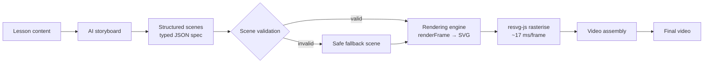
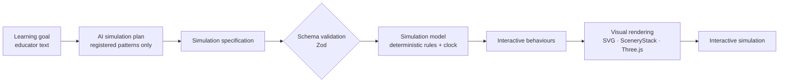
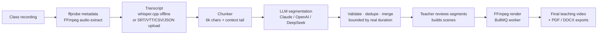
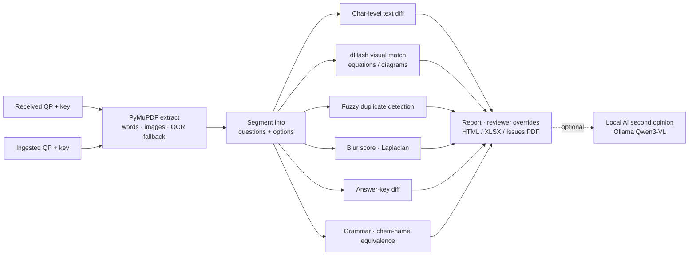

# Sagar | AI-Powered EdTech Products

I build educational technology products using **Claude, Claude Code, OpenAI Codex and ChatGPT** as engineering partners. My work focuses on interactive learning, educational video generation, classroom-content automation and reusable systems that make high-quality educational content easier to create.

I lead **product definition, architecture decisions, implementation review and testing**, and use AI-assisted development to speed up the engineering. These products are built for K–12 education at Narayana Group.

My core rule: **let the AI make decisions, let deterministic code produce the output.** Model output is treated as untrusted input. It is bounded, validated, and degrades safely instead of producing a wrong result.

---

##  Tech stack

| Area | Tools |
| --- | --- |
| Languages | TypeScript, JavaScript, Python, SQL |
| Frontend | React, Vite, Tailwind, HTML5 Canvas, SVG, Three.js / React Three Fiber |
| Rendering | SVG-based graphics, SceneryStack, resvg-js, MathJax, Blender |
| Backend | NestJS, Flask, Node.js, Prisma, BullMQ + Redis, JWT auth |
| AI-assisted development | Claude, Claude Code, OpenAI Codex, ChatGPT |
| AI in products | Claude / OpenAI / DeepSeek provider adapters, Ollama (local Qwen-VL), whisper.cpp |
| Media & documents | FFmpeg / ffprobe, PyMuPDF, pdfplumber, Tesseract OCR, LanguageTool, RDKit |
| Data | Polars, DuckDB, Parquet, SQLite, openpyxl |
| Validation & testing | Zod, Vitest, regression suites on real documents |
| Delivery | PyInstaller single-file apps, pnpm monorepos, Docker Compose |

---

##  Products

### 1. AI Educational Video Engine
*Transforms lesson content into animated explainer videos for NCERT Grades 6–12.*

**Key capabilities**
- **Structured storyboards and scene specs.** The AI never writes code or pixels. It fills a small typed spec per scene, and deterministic TypeScript computes the geometry, motion and colour.
- **Validation before rendering.** Invalid specs fall back to a plain text or shape scene instead of crashing the video.
- **Rendering as a pure function:** `renderFrame({ scene, t, durationSeconds }) → SVG`, rasterised by `resvg-js` (Rust). There is no headless browser or GPU in production.
- **Reusable components for 15 scene types:** geometry, physics, chemistry (ionic bonding), biology processes, function graphing, Venn diagrams with boolean shape operations, timelines, quizzes and more. An 18-element doodle system extends coverage to Geography, Civics, History and Economics.
- **Equations, diagrams and scientific processes:** MathJax typesetting passes 27 of 28 test expressions. Blender composites 3D-model tours.
- **Modular architecture** for expanding across subjects, backed by about 150 automated tests.
- **Documented trade-offs:** I rejected Motion Canvas as a second engine, because it meant a browser dependency and AI-generated code. Instead I proposed a **hybrid** approach: a cached AI backdrop per lesson with code-drawn, always-correct labels on top.

---

### 2. SimLab: Interactive Simulation Engine
*Creates interactive learning experiences for Mathematics, Physics, Chemistry and Biology. An educator describes a learning goal; the system builds a simulation students can explore.*

**Key capabilities**
- **Schema-driven simulation definitions.** A serialisable `SimulationDefinition` describes the world, objects, relationships, interactions and pedagogy, and is validated with **Zod**.
- **The AI configures, it doesn't code.** The server publishes a catalogue of what it can do, and the AI selects and configures registered patterns. It can't supply executable rules or UI code. A plan that needs unsupported behaviour can't be published as ready.
- **Deterministic model and clock.** Scientific state (position, velocity, gravity, time) lives in the domain model, separate from rendering. Play, pause, step, seek and reset run independently of animation frames.
- **Reusable visual components and controls** for parameter-driven experiments with real-time updates, live graphs, measurements and full keyboard accessibility.
- **Multi-provider AI** (OpenAI, Claude, DeepSeek) runs behind server-side adapters. Keys never reach the browser, and long generations stream.
- **Automated tests of simulation behaviour:** 20+ Vitest test files covering rules, validation, interaction, pedagogy and publishing.

**Example concepts:** projectile motion (with Moon, Earth and Jupiter gravity presets), sound waves, refraction of light, circuits, electrostatics (a gold-leaf electroscope) and speed–distance–time.

---

### 3. Class2Clips: AI Classroom Video Cleaner
*Turns a long classroom recording into clean, concept-focused teaching videos.*

- **Architecture:** a pnpm monorepo with a **NestJS** API (JWT auth, role guards), a **React + Vite + Tailwind** frontend and an async **video worker** (BullMQ on Redis). It uses **Prisma** on SQLite, ready for Postgres. Storage, queue, AI and transcription each sit behind a provider interface.
- **The AI finds the teaching:** the LLM identifies the segments where the teacher is actually explaining (skipping chit-chat) and returns them with confidence scores. A second pass groups them by concept, subtopic and topic into scene recommendations.
- **Defensive LLM handling:**
  - Transcripts are chunked by character budget, carrying a context tail so an explanation crossing a boundary isn't split in two.
  - Every model-returned timestamp is bounded against the real video duration. *In testing, one model returned an end time of about 277 hours on a 96-minute recording.*
- **Human in the loop:** the AI only runs when a user presses a button. Teachers approve or remove segments and preview before anything is rendered.
- **Private and cost-aware:** video, transcripts and the database stay on the machine. API keys are encrypted, and transcription can run fully offline.

---

### 4. Question Paper QA Automation
*Checks every exam paper against its online-ingested version, question by question and option by option.*

- **Deterministic core:** built on Flask, PyMuPDF, pdfplumber and RapidFuzz.
  - Text is compared at character level on the PDF's embedded text, down to the punctuation.
  - Equations and diagrams are cropped side by side with a perceptual-hash similarity hint.
  - Blurry images are flagged by Laplacian variance.
- **Domain-aware checks:**
  - Grammar is cross-checked against the received paper, so the academic team's own wording isn't blamed on ingestion.
  - Chemistry names are matched as equivalents ("ethanoic acid" = "acetic acid") using OPSIN and RDKit.
- **A benchmarked local AI layer:** a vision model running on Ollama (`qwen3-vl:2b`) gives an optional second opinion on flagged figures.
  - Benchmarked on 34 real, verified cases: **84.8% accuracy, 6 of 7 real defects caught.**
  - Its confidence scores proved unreliable, so it is advisory only and never changes the verdict.
- **Validated on 7 real papers.** Bugs fixed this way include Cyrillic look-alike option markers and a missing full stop that hid 17 questions.
- **Graceful degradation:** Java, Tesseract and Ollama are each optional. Rolled out to the QA team with install guides for Windows and Mac.

---

### 5. Engagement Analytics
*Turns daily exam-engagement files with millions of rows into dashboards, comparisons and reports, on 8 GB office laptops.*

- **Shipped as a single-file Windows app** (`EngagementAnalytics.exe`). It opens a local browser UI, processes everything on the machine and keeps uploaded data between sessions.
- **A data hub with schema validation:** five input files, each checked against the expected columns, with clear errors before anything is loaded.
- **Built for a 1.5 GB memory budget** using Polars streaming, DuckDB and Parquet:
  - 2.86 M rows (546 MB CSV) loaded and grouped in **9.8 s**
  - Stored as Parquet at **59 MB**, re-queried in **0.02 s**
- **A zero-hallucination AI summary design:** the LLM only rewrites a pre-computed fact sheet. Every number in its output is checked against that fact sheet before display, with a template fallback.

---

### 6. More builds

- **Clearline:** a local Python app that turns five weekly call-centre exports (agent productivity, call summaries with AHT, call and ticket dumps) into ready reports. It was packaged with step-by-step installers for non-technical users on Windows and Mac mini.
- **Work & Power Lab:** a CBSE Class 9 physics simulation in vanilla JS and Canvas. It has an animated cyclist with two-link inverse kinematics, live W–F, W–d and P–t graphs, self-checking activities and a target challenge.
- **NCERT 3D Asset Catalog:** 49 hand-verified, openly licensed 3D models (Smithsonian, NASA, NIH, Sketchfab CC0, Poly Haven) mapped to the syllabus, with a gap analysis.

---

##  Engineering principles

- **Structured inputs:** use defined specifications instead of unrestricted generated code wherever practical.
- **Deterministic execution:** keep calculations and critical behaviour in explicit, testable logic.
- **Validation first:** detect invalid inputs, and bound every model output, before rendering or execution.
- **Reusable architecture:** build shared components instead of isolated demonstrations.
- **Test real outputs:** verify the actual frames, PDFs and numbers, not just that the code runs.
- **Benchmark the AI:** measure accuracy on real, verified cases before a model reaches users, and say plainly where it falls short.
- **Spec first:** write a PRD or decision memo before large features, covering options, costs, failure modes and a recommendation.
- **Local-first and cost-aware:** run on hardware the team already has, call AI only when a person asks, and keep data on the machine.

---

##  Vision

To build scalable educational tools that combine AI-assisted development with reliable rendering, interactive experiments and curriculum-aligned learning, so that high-quality teaching content becomes faster and cheaper to create and stays correct.

---

##  Contact
linkedin.com/in/sagar-v-37629a190

<!-- Add your LinkedIn / email here -->
